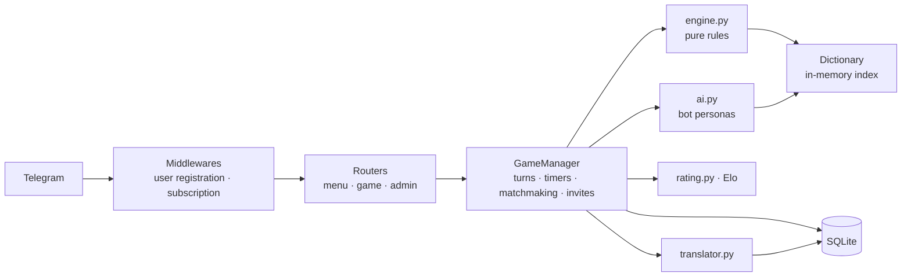

# 🔤 Word Chain — English vocabulary game for Telegram

**English** · [O'zbekcha](README.uz.md)

[](https://xoliddev.github.io/demos/wordchain-bot/)

> *Telegram uchun inglizcha so'z zanjiri o'yini: bot bilan yoki do'stlar bilan o'ynab, so'z boyligingizni oshiring.*


[](https://github.com/xoliddev/wordchain-bot/actions/workflows/tests.yml)


A classic word-chain game as a Telegram bot: every word must start with the last letter of the previous one —
*apple → egg → green → …*. Play against a human-like bot that only knows words of its CEFR level (A1–C2),
against a random opponent with Elo matchmaking, or against a friend via an invite link. After each game the
bot shows the words it used, with their level and **Uzbek translation**, so the game doubles as a vocabulary
trainer for Uzbek learners of English.

## ✨ Features

- **🤖 Human-like bot opponent.** Six personas (A1–C2), each with its own vocabulary, "typing" delay,
  fatigue that grows over a long game, a higher chance to blank out on letters it knows few words for, and —
  at higher levels — the cunning to leave you letters that are hard to continue.
- **👥 Random opponent (PvP).** Matchmaking first looks for players with a similar level and rating;
  after 30 s any level is accepted, after 45 s the bot offers a game against itself.
- **🔗 Play with a friend.** Deep-link invites, valid for 10 minutes.
- **⚖️ Referee.** Dictionary check, no repeats, correct first letter, minimum length, turn timer;
  3 strikes and you lose. Accepted words get a 👍 / 🔥 reaction.
- **⭐ Elo rating** (PvP only, K = 32), leaderboard, stats, win streaks and a personal vocabulary
  broken down by CEFR level.
- **💡 Hints** in bot games: only part of the word is revealed — `e l _ _ _ _ _ t`.
- **🇺🇿 Cached translations.** Each word is translated once and stored in the `translations` table;
  admin corrections (`/tr word = translation`) are never overwritten. If the translation service is down,
  words are simply shown without it.
- **🛠 Admin panel.** Stats, add/remove words, review player reports (📩 "this word is valid",
  🚩 "this word is wrong") in one tap, broadcast to all users with rate limiting.
- **📢 Optional required subscription** to a channel (never checked mid-game).

## 🏗 Architecture

The game rules are pure Python with no Telegram or database dependencies, so they are fully unit-tested;
the aiogram layer is tested end-to-end by feeding real `Update` objects through the dispatcher with a fake
Bot API session.



```
bot/
├── engine.py        game rules (no Telegram, pure Python)
├── ai.py            bot opponent: levels, persona, strategy
├── dictionary.py    in-memory word index for fast lookups
├── game_manager.py  live games: turns, timers, matchmaking, invites
├── rating.py        Elo rating
├── translator.py    EN → UZ translations, cached in the DB
├── db.py            SQLite: users, words, games, moves, user_words, word_reports, translations
├── handlers/        aiogram routers (menu, game, admin)
├── middlewares.py   user registration, required subscription
├── notifier.py      Telegram side effects (messages, reactions)
├── texts.py         all user-facing texts (Uzbek)
└── data/words.txt   bundled dictionary (~38 000 words, ordered by frequency)
scripts/             dictionary build pipeline
tests/               rules, bot opponent, full game flow through the dispatcher
```

## 🚀 Quick start

### 1. Configure

```bash
cp .env.example .env    # fill in BOT_TOKEN and ADMIN_IDS
```

| Variable | Required | Default | Description |
|---|---|---|---|
| `BOT_TOKEN` | ✅ | — | Bot token from [@BotFather](https://t.me/BotFather) |
| `ADMIN_IDS` | | *(empty)* | Comma-separated Telegram user ids allowed to use `/admin` |
| `DB_PATH` | | `data/wordchain.db` | SQLite file (relative to project root) |
| `REQUIRED_CHANNEL` | | *(empty)* | `@channel` users must join; the bot must be an admin there |
| `REQUIRED_CHANNEL_LINK` | | *(empty)* | Invite link, only needed for private channels |
| `PVP_TURN_SECONDS` | | `45` | Seconds per turn in PvP |
| `MAX_STRIKES` | | `3` | Mistakes allowed before losing |
| `MAX_HINTS` | | `2` | Hints per bot game |
| `TRANSLATE` | | `1` | Show Uzbek translations in the game summary (`0` to disable) |

### 2. Run locally

```bash
python -m venv .venv
# Windows: .venv\Scripts\activate    Linux/macOS: source .venv/bin/activate
pip install -r requirements.txt
python -m bot
```

On first start the words from `bot/data/words.txt` are loaded into the database; from then on the dictionary
lives in the `words` table and can be edited by admins.

### 3. Docker

```bash
docker build -t wordchain .
docker run -d --name wordchain --restart unless-stopped \
  --env-file .env -v wordchain-data:/app/data wordchain
```

## 🧪 Tests

```bash
pip install -r requirements-dev.txt
python -m pytest -q
```

## 📚 Dictionary pipeline

`bot/data/words.txt` is generated by `scripts/build_words.py`:

1. **Frequency (`wordfreq`).** Words are ranked by real-world usage and mapped to CEFR levels
   (top 1 000 → A1, up to 2 500 → A2, and so on — see `bot/levels.py`).
2. **Dictionary filter (`english-words`, Webster web2).** Only real words survive; names, cities and brands are
   dropped; inflected forms (*apples*, *running*) are detected by simple rules. Hunspell is used instead when
   available (`apt install hunspell-en-us`) or passed with `--dict`.
3. **`scripts/extra_words.txt`** — valid words missing from the old dictionary (*internet*, *laptop*, British spellings).
4. **`scripts/blocked_words.txt`** — profanity and chat slang are never accepted.

Each build also writes `scripts/rejected_review.txt` — frequent words that were rejected — for manual review.

```bash
pip install -r requirements-dev.txt
python scripts/build_words.py
```

The bot reads `words.txt` only when the `words` table is empty. To reload, run `DELETE FROM words;` on the
database and restart. During play, users flag words with 🚩 and admins approve them via `/reports`.

## ⌨️ Commands

| Player | | Admin | |
|---|---|---|---|
| `/start` | main menu | `/admin` | stats |
| `/play` | vs bot | `/addword word B1` | add a word |
| `/pvp` | random opponent | `/delword word` | remove a word |
| `/friend` | invite a friend | `/word word` | word info |
| `/hint` `/giveup` `/cancel` | in game | `/tr word = translation` | fix a translation |
| `/stats` `/top` `/level` `/rules` | profile | `/reports` | review player reports |
| | | `/broadcast` (as a reply) | message everyone |

## 📄 License

[MIT](LICENSE) © 2026 xoliddev
