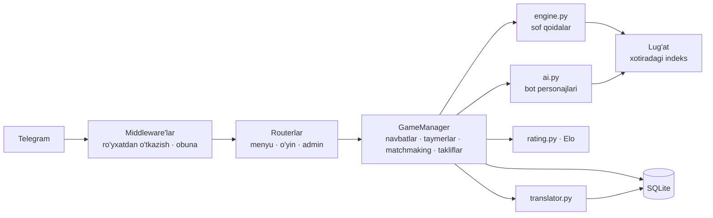

# 🔤 Word Chain — Telegram uchun inglizcha so'z o'yini

[English](README.md) · **O'zbekcha**

[](https://xoliddev.github.io/demos/wordchain-bot/)

> *Telegram uchun inglizcha so'z zanjiri o'yini: bot bilan yoki do'stlar bilan o'ynab, so'z boyligingizni oshiring.*


[](https://github.com/xoliddev/wordchain-bot/actions/workflows/tests.yml)


Klassik so'z zanjiri o'yini, Telegram bot ko'rinishida: har bir so'z oldingi so'zning oxirgi harfi bilan
boshlanishi kerak — *apple → egg → green → …*. Faqat o'z CEFR darajasidagi (A1–C2) so'zlarni biladigan,
odamga o'xshab o'ynaydigan bot bilan, Elo reytingi bo'yicha tanlangan tasodifiy raqib bilan yoki taklif
havolasi orqali do'stingiz bilan o'ynashingiz mumkin. Har bir o'yindan keyin bot ishlatilgan so'zlarni
darajasi va **o'zbekcha tarjimasi** bilan ko'rsatadi — shuning uchun o'yin ingliz tilini o'rganayotgan
o'zbeklar uchun so'z yodlash trenajyori vazifasini ham bajaradi.

## ✨ Imkoniyatlar

- **🤖 Odamga o'xshagan bot-raqib.** Oltita personaj (A1–C2), har birining o'z so'z boyligi, "yozish"
  kechikishi, uzoq o'yinda ortib boradigan charchoq holati bor; kam so'z biladigan harflarda ko'proq
  "qotib qoladi", yuqori darajalarda esa sizga davom ettirish qiyin bo'lgan harflarni qoldiradigan ayyorlik
  ham bor.
- **👥 Tasodifiy raqib (PvP).** Matchmaking avval darajasi va reytingi yaqin o'yinchilarni qidiradi;
  30 soniyadan keyin istalgan daraja qabul qilinadi, 45 soniyadan keyin bot o'zi bilan o'ynashni taklif qiladi.
- **🔗 Do'st bilan o'ynash.** Deep-link orqali taklif, 10 daqiqa amal qiladi.
- **⚖️ Hakam.** Lug'atdan tekshirish, takrorlash mumkin emas, birinchi harf to'g'ri bo'lishi, minimal uzunlik,
  navbat taymeri; 3 ta xato — mag'lubiyat. Qabul qilingan so'zlarga 👍 / 🔥 reaksiya qo'yiladi.
- **⭐ Elo reytingi** (faqat PvP, K = 32), reytinglar jadvali, statistika, ketma-ket g'alabalar va CEFR
  darajalari bo'yicha shaxsiy so'z boyligi.
- **💡 Yordamchi maslahatlar** bot bilan o'yinda: so'zning faqat bir qismi ochiladi — `e l _ _ _ _ _ t`.
- **🇺🇿 Keshlangan tarjimalar.** Har bir so'z bir marta tarjima qilinib, `translations` jadvalida saqlanadi;
  admin tuzatishlari (`/tr word = tarjima`) hech qachon ustidan yozilmaydi. Tarjima servisi ishlamay qolsa,
  so'zlar shunchaki tarjimasiz ko'rsatiladi.
- **🛠 Admin panel.** Statistika, so'z qo'shish/o'chirish, o'yinchilar shikoyatlarini (📩 "bu so'z to'g'ri",
  🚩 "bu so'z noto'g'ri") bir bosishda ko'rib chiqish, barcha foydalanuvchilarga limit bilan xabar tarqatish.
- **📢 Ixtiyoriy majburiy obuna** kanalga (o'yin o'rtasida hech qachon tekshirilmaydi).

## 🏗 Arxitektura

O'yin qoidalari Telegram va bazaga bog'liq bo'lmagan sof Python'da yozilgan, shuning uchun ular to'liq
unit-testlar bilan qoplangan; aiogram qatlami esa end-to-end testlanadi: haqiqiy `Update` obyektlari
soxta Bot API sessiyasi bilan dispatcher orqali o'tkaziladi.



```
bot/
├── engine.py        o'yin qoidalari (Telegram'siz, sof Python)
├── ai.py            bot-raqib: darajalar, personaj, strategiya
├── dictionary.py    tez qidirish uchun xotiradagi so'zlar indeksi
├── game_manager.py  jonli o'yinlar: navbatlar, taymerlar, matchmaking, takliflar
├── rating.py        Elo reytingi
├── translator.py    EN → UZ tarjimalar, bazada keshlanadi
├── db.py            SQLite: users, words, games, moves, user_words, word_reports, translations
├── handlers/        aiogram routerlari (menu, game, admin)
├── middlewares.py   foydalanuvchini ro'yxatdan o'tkazish, majburiy obuna
├── notifier.py      Telegram tomondagi amallar (xabarlar, reaksiyalar)
├── texts.py         foydalanuvchiga ko'rinadigan barcha matnlar (o'zbekcha)
└── data/words.txt   tayyor lug'at (~38 000 so'z, ishlatilish chastotasi bo'yicha tartiblangan)
scripts/             lug'atni yig'ish pipeline'i
tests/               qoidalar, bot-raqib, dispatcher orqali to'liq o'yin jarayoni
```

## 🚀 Tez boshlash

### 1. Sozlash

```bash
cp .env.example .env    # BOT_TOKEN va ADMIN_IDS ni to'ldiring
```

| O'zgaruvchi | Majburiy | Standart | Tavsif |
|---|---|---|---|
| `BOT_TOKEN` | ✅ | — | [@BotFather](https://t.me/BotFather) bergan bot tokeni |
| `ADMIN_IDS` | | *(bo'sh)* | `/admin` dan foydalana oladigan Telegram user id'lar, vergul bilan |
| `DB_PATH` | | `data/wordchain.db` | SQLite fayli (loyiha ildiziga nisbatan) |
| `REQUIRED_CHANNEL` | | *(bo'sh)* | Foydalanuvchilar a'zo bo'lishi kerak bo'lgan `@kanal`; bot u yerda admin bo'lishi shart |
| `REQUIRED_CHANNEL_LINK` | | *(bo'sh)* | Taklif havolasi, faqat yopiq kanallar uchun kerak |
| `PVP_TURN_SECONDS` | | `45` | PvP'da bitta navbat uchun soniyalar |
| `MAX_STRIKES` | | `3` | Mag'lubiyatgacha ruxsat etilgan xatolar soni |
| `MAX_HINTS` | | `2` | Bot bilan bitta o'yindagi maslahatlar soni |
| `TRANSLATE` | | `1` | O'yin yakunida o'zbekcha tarjimalarni ko'rsatish (`0` — o'chirish) |

### 2. Lokal ishga tushirish

```bash
python -m venv .venv
# Windows: .venv\Scripts\activate    Linux/macOS: source .venv/bin/activate
pip install -r requirements.txt
python -m bot
```

Birinchi ishga tushganda `bot/data/words.txt` dagi so'zlar bazaga yuklanadi; shundan keyin lug'at
`words` jadvalida yashaydi va uni adminlar tahrirlay oladi.

### 3. Docker

```bash
docker build -t wordchain .
docker run -d --name wordchain --restart unless-stopped \
  --env-file .env -v wordchain-data:/app/data wordchain
```

## 🧪 Testlar

```bash
pip install -r requirements-dev.txt
python -m pytest -q
```

## 📚 Lug'at pipeline'i

`bot/data/words.txt` fayli `scripts/build_words.py` orqali yaratiladi:

1. **Chastota (`wordfreq`).** So'zlar real hayotda qanchalik ko'p ishlatilishiga qarab tartiblanadi va CEFR
   darajalariga bog'lanadi (eng ko'p ishlatiladigan 1 000 tasi → A1, 2 500 gacha → A2 va hokazo — `bot/levels.py` ga qarang).
2. **Lug'at filtri (`english-words`, Webster web2).** Faqat haqiqiy so'zlar qoladi; ismlar, shaharlar va
   brendlar chiqarib tashlanadi; so'z shakllari (*apples*, *running*) oddiy qoidalar bilan aniqlanadi. Agar
   Hunspell o'rnatilgan bo'lsa (`apt install hunspell-en-us`) yoki `--dict` bilan berilsa, o'rniga u ishlatiladi.
3. **`scripts/extra_words.txt`** — eski lug'atda yo'q, lekin to'g'ri so'zlar (*internet*, *laptop*, britancha yozilishlar).
4. **`scripts/blocked_words.txt`** — so'kinish va chat jargoni hech qachon qabul qilinmaydi.

Har bir yig'ishda `scripts/rejected_review.txt` ham yoziladi — rad etilgan, lekin ko'p ishlatiladigan so'zlar
ro'yxati, qo'lda ko'rib chiqish uchun.

```bash
pip install -r requirements-dev.txt
python scripts/build_words.py
```

Bot `words.txt` ni faqat `words` jadvali bo'sh bo'lganda o'qiydi. Qayta yuklash uchun bazada
`DELETE FROM words;` ni bajaring va botni qayta ishga tushiring. O'yin davomida foydalanuvchilar so'zlarni
🚩 bilan belgilaydi, adminlar esa ularni `/reports` orqali tasdiqlaydi.

## ⌨️ Buyruqlar

| O'yinchi | | Admin | |
|---|---|---|---|
| `/start` | bosh menyu | `/admin` | statistika |
| `/play` | bot bilan | `/addword word B1` | so'z qo'shish |
| `/pvp` | tasodifiy raqib | `/delword word` | so'zni o'chirish |
| `/friend` | do'stni taklif qilish | `/word word` | so'z haqida ma'lumot |
| `/hint` `/giveup` `/cancel` | o'yin ichida | `/tr word = tarjima` | tarjimani tuzatish |
| `/stats` `/top` `/level` `/rules` | profil | `/reports` | o'yinchilar shikoyatlarini ko'rish |
| | | `/broadcast` (reply sifatida) | hammaga xabar yuborish |

## 📄 Litsenziya

[MIT](LICENSE) © 2026 xoliddev
